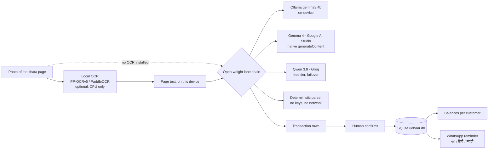

# Udhaar Book

Photograph a page of a shop's handwritten credit notebook (`khata`) and get
running balances, plus the polite WhatsApp message that asks for the money back
— in the customer's own language.

Credit given on a page nobody re-reads is money quietly lost. That is the whole
product.

## Who it is for

A neighbourhood kirana, medical or vegetable shop. One shared Android phone, a
paper book, no laptop at the counter. They use it at closing time, alone, in
under a minute — and again at month end, when the money matters most.

## How it works



The confirm step is not a concession to imperfect AI. A book about money should
be checked by the person whose money it is.

## The open part

The models that read the book are **open-weight** and swappable by environment
variable, so a shop is never renting access to its own ledger:

| Lane | Model | Weights | Cost |
|---|---|---|---|
| On-device | `gemma3:4b` via Ollama | [Gemma](https://huggingface.co/google/gemma-3-4b-it) | free, offline |
| Hosted | `gemma-4-26b-a4b-it` via Google AI Studio | open weights | free tier |
| Failover | `qwen/qwen3.8-27b` via Groq | open weights | free tier |
| No keys | built-in regex parser | — | free |

Gemma 4 on AI Studio is served on the native `generateContent` route, not the
OpenAI-compatible one — Gemma 3 was retired from the Gemini API in 2026. That is
the only lane with a small protocol adapter; Ollama and Groq still speak plain
chat-completions. The default is the 26B-A4B MoE (fast, reliable on the free
tier); set `AI_STUDIO_MODEL=gemma-4-31b-it` for the heavier dense model.

Point `OLLAMA_BASE_URL` at a local model and the whole pipeline runs on the
shop's own machine with no code change. The OCR layer is open source too
(PaddleOCR / PP-OCRv5), and it runs on CPU — no GPU anywhere in this project.

## Run it

```bash
python -m venv .venv && .venv\Scripts\activate     # Windows
# source .venv/bin/activate                        # macOS/Linux
pip install -r requirements.txt

copy .env.example .env        # optional: add one free key
uvicorn app:app --reload      # http://127.0.0.1:8000
```

No key at all? Tick **use the sample page** and everything still runs, end to
end, on the built-in parser. That is deliberate: a reviewer should never hit a
dead end.

## Deploy

One free Render blueprint, no database service, no card:

**[`docs/deploy.md`](docs/deploy.md)** — get a free AI Studio key, press Deploy,
then read `/healthz` to see which reader lanes are actually live.

Want the on-device reader too:

```bash
pip install -r requirements-ocr.txt
```

## Tests

Neither suite needs a test framework installed:

```bash
python tests/test_pipeline.py    # 4 checks: parsing, money maths, reminders, no-key path
python tools/smoke_http.py       # 20 checks against a running server
```

`tools/smoke_http.py` expects the app on `http://127.0.0.1:8000`. It includes the
check that matters most for a stranger clicking through: uploading a photo with
no OCR backend and no key must answer **200 with an honest explanation**, not a
500 and not a blank table.

## Environment

Every value is optional. See `.env.example`.

| Variable | What it does |
|---|---|
| `SHOP_NAME`, `SHOP_LANG` | Name and default language for reminders (`en`, `hi`, `mr`) |
| `AI_STUDIO_API_KEY` | Free key, no card: <https://aistudio.google.com/apikey> |
| `GROQ_API_KEY` | Failover lane: <https://console.groq.com/keys> |
| `OLLAMA_BASE_URL`, `OLLAMA_MODEL` | Run the whole thing on-device |
| `OCR_BACKEND` | `auto`, `rapidocr`, `paddleocr`, `tesseract`, or `none` |
| `UDHAAR_DB` | Where the SQLite file lives |

## What is real, and what is synthetic

- `samples/sample_ledger.txt` and `samples/hard_page.txt` are **hand-written
  fixtures** for demos and tests. They are not a real shop's page.
- There is **no real user yet**. Nothing in this repo claims a field test, and
  nothing should be written up as one until it actually happens.
- Real pages carry real names. `field-photos/` and `samples/real/` are
  git-ignored out of the box.

## Honest limitations

- Handwriting is hard. A smudged or badly lit page loses lines; the app is
  built to show what it could not read rather than to hide it.
- Devanagari handwriting is the weakest case, and the OCR backend may not have
  wheels for your Python version — in which case the model lane reads the image
  and the on-device claim does not hold for that run.
- A reminder figure always comes from the ledger, never from a model. Models
  may only soften the wording.
- No payments, no UPI link, no multi-shop support, no login. Deliberately.

## Licence

MIT — see [LICENSE](LICENSE).
